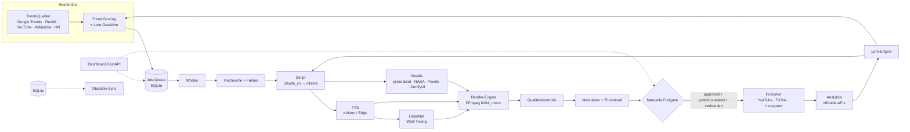

<!-- cf:auto:start – dieser Block wird automatisch erzeugt -->
# Systemarchitektur

## Komponenten
| Modul | Aufgabe |
|---|---|
| `factory/trends` | Trend-Signale sammeln und bewerten |
| `factory/research.py`, `scriptwriter.py`, `llm.py` | Recherche, Skript, Faktencheck |
| `factory/tts.py`, `audio.py` | Stimme, Musik, SFX, Loudness |
| `factory/visuals`, `render.py`, `subtitles.py` | Bild, Animation, Untertitel, Encoding |
| `factory/qc.py`, `metadata.py` | Qualitätskontrolle, Titel/Beschreibung/Hashtags |
| `factory/publish/*` | Freigabe, Zeitplan, Uploads (offizielle APIs) |
| `factory/analytics.py`, `learning.py` | echte Metriken, Selbstoptimierung |
| `factory/secrets.py` | Schlüssel im Windows-Anmeldeinformationsspeicher |
| `factory/obsidian.py` | diese Dokumentation |
<!-- cf:auto:end -->
